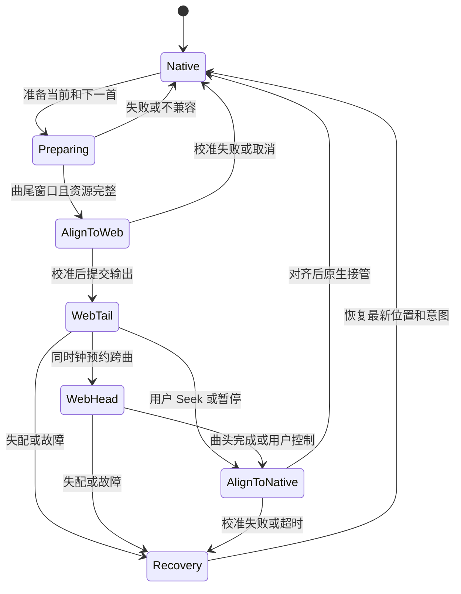

# Windows 无缝播放实施方案

方案 v8，2026-11-14。目标与 Mac 当前源码 0.1.11 一致：只增加无缝衔接，普通音乐播放归网易云原生；需要 Web Audio 时仅覆盖相邻曲目的尾部和开头，双向对齐后交还原生。授权、音质选择、音量、队列、歌词、音效及窗口样式遵循网易云。

这是 Windows 开发与验收方案。仓库尚无 Windows 适配器、安装包或实机记录；Mac 设备声音回录、系统图标闪动及更多异常组合也仍有未验收项。不能把文档、原生回退或复制 Mac 日志当作 Windows 功能已经实现。依据见 [临时桥接](TEMPORARY_WEB_BRIDGE.md)、[缓存策略](CACHE_PRIORITY.md) 和 [本轮检查](IMPLEMENTATION_CHECK_0.1.11.md)。

## 1. 统一功能边界

| 项目 | 两端一致的要求 |
|---|---|
| 日常播放 | 网易云原生后端出声；准备缓存不改变后端、曲名、进度或状态 |
| Web 桥接 | 当前曲尾约 10 秒才允许进入，B 开头实际输出约 10 秒后对齐交还；10 秒是窗口，不是盲切定时器 |
| 相邻曲目 | 同一 AudioContext 中提前预约 B，从 A 缓冲结束时间开始；保留作品留白，不裁剪或交叉淡化 |
| 音源和音质 | 当前账号和用户选择对应的原生授权播放源；匹配实际档位和内容身份；无低码率兜底 |
| 缓存优先 | 已解码内存 → 完整且同源的网易云磁盘缓存 → 当前授权音源 |
| 控制 | 原生窗口、媒体键、系统卡片的暂停、继续、Seek、前后切歌始终有效；同一次输入只执行一次 |
| UI | 宿主已有设置页仅一项「无缝播放」开关；主窗口、歌词、主题和音量/进度控件沿用原生 |
| 恢复 | 关闭、取消、不兼容、设备变化或异常时恢复同曲目、最新位置、音量和意图；释放 Web 音乐资源 |
| 不兼容 | 未知版本、无法确认队列、音源/规格/原生处理不兼容时保持原生，不称该边界无缝成功 |

同音质选择和编码源，不等于两种解码器、float32 PCM、系统混音和设备输出比特一致。指定设备、独占/直通、空间音效或网易云音效无法沿用时保持原生，不偷偷关闭用户设置。

## 2. 先验证原生能力

优先采用真实原生预准备及连续输出能力。验证必须在指定 Windows 客户端、宿主、系统和输出设备上进行，保存准确版本及能力结果；函数存在或 Promise 成功不算可用。

| 能力 | 所需证据 | 无能力时 |
|---|---|---|
| 下一首预准备 | 实际调用、完成事件；准备期间 A 继续出声、不提前切 UI/系统曲名 | 再评估临时 Web 桥接 |
| 原生连续输出 | A→B 实际声音连续，控制正常，无额外 DSP/音质变化 | 不能宣称全原生无缝 |
| 原生静默准备 | B 独立 Load/Seek/启动，Web 不停；准备不触发第二次选曲 | 不进入无法交还的 Web 桥接 |
| 输出选择 | 暂时关闭准备中的原生声音且可靠恢复最新用户音量 | 保持原生 |
| 原生计时 | 单位、更新周期、Seek/暂停语义已测，有可说明误差的位置估算 | 保持原生，不按固定 10 秒强行切换 |
| 队列与授权 | 本次实例、可信下一首、当前账号授权和实际源可确认 | 保持原生 |
| 系统媒体发布 | 能避免内部 pause/Load 覆盖真实状态，保持一个权威发布者 | 系统一致性未达标，不宣布可发布 |
| 异步缓存读取 | 元数据、字节流可限时/取消，不阻塞页面 | 回退授权源，不扩大磁盘权限 |

Mac 3.1.12 的 `preLoad` 和 `getPlaybackInfo` 为空，不代表 Windows 同名方法也为空。Windows 命令、事件、模块编号、码率标记和缓存路径必须实查，禁止复制 Mac 绑定后假定能运行。[原生可行性报告](NATIVE_GAPLESS_FEASIBILITY.md)

NcmGaplessPlayer 可参考注册捕获和预约结构，不能整包移植。参考提交固定为 `87e444c4599aac97f4a0de74421cea7853bbf1bc`；启动代码记录 `channel.registerCall` 与 `legacyNativeCmder.appendRegisterCall` 的 JS 处理器，原生通知和 JS UI 调用应分开。临时窗口、交还、系统发布与缓存协议仍须适配；不移植调音/主题/歌词面板或低码率兜底。[启动入口](https://github.com/AntsandIce/NcmGaplessPlayer/blob/87e444c4599aac97f4a0de74421cea7853bbf1bc/src/startup_script.js)，[播放源码](https://github.com/AntsandIce/NcmGaplessPlayer/blob/87e444c4599aac97f4a0de74421cea7853bbf1bc/src/main.js)

## 3. 复用现有代码，减少重复实现

| 已有文件 | 职责 |
|---|---|
| `shared/audio-resources.js` | 授权源、可注入缓存读取、流式限额、串行独立解码、内容缓存和取消 |
| `shared/playback-clock.js` | 唯一音乐上下文、预约、设备输出时戳、输出开关、Seek 和资源释放 |
| `mac/player.js` | 桥接、控制代次、接认和恢复；平台无关部分须抽取共用 |
| `mac/native-cache.js` | Mac 缓存协议；Windows 复用身份/完整性规则，重新实现读取 |
| `mac/startup.js`、`mac/media-session.js` | Mac 原生桥和系统控制，不能直接运行于 Windows |

以下是必要的新增规划文件，当前尚不存在：

```text
shared/bridge-controller.js   从 mac/player.js 抽取桥接、控制与恢复状态机
windows/startup_script.js     尽早捕获注册/原始通道，建立可撤销包装
windows/adapter.js            原生控制、队列、授权、计时和系统媒体绑定
windows/native-cache.js       Windows 缓存记录、异步字节流及格式校验
windows/entry.js              能力检查、已有设置页开关、接线和退出
windows/manifest.json         实测客户端/宿主声明
windows/package.py            组合共享代码与适配器，生成 ZIP 插件
```

使用普通 JavaScript 和同一个桥接核心，不新增前端框架、播放面板、波形分析、独立音乐播放器或常驻音乐服务。平台能力优先复用宿主；没有接口时记录阻挡，不自动新增音频代理进程掩盖缺口。不得在两端复制两套独立状态机。

## 4. 数据与适配器契约

以下是项目契约名称，不是已发现的网易云函数名。

| 数据对象 | 必需字段 |
|---|---|
| 播放实例 | 曲目 ID、队列发生实例、完整原生 playId、Load/控制代次、队列版本、播放意图 |
| 音源 | 账号/授权代次、请求及实际档位、完整原生 Load 参数、大小、MD5/指纹、授权/试听标记 |
| 解码资源 | 内容身份、编码规格、源采样率/声道/帧数、解码规格、AudioBuffer、预算、引用数、来源 |
| 原生位置 | 位置、单位、捕获时间、运行状态、累计听音计数语义、误差估计 |
| 交接事务 | 本次实例、源身份、原生恢复资料、切换时刻、控制代次、输出是否提交、End 是否已通知 |

听音累计值不是曲目进度。缓存可复用内容，控制和 End 绑定本次实例。Mac 对重复曲目 ID 保持原生；Windows 未确认整条接认链路前使用相同策略。

| 适配器能力 | 约束 |
|---|---|
| `probeCapabilities` | 分项能力及缺失原因，未知客户端放行原生 |
| `readSnapshot` / `observeNative` | 规范化位置/状态/队列，标明来源/实例，不改设置 |
| `installCommandHook` | 保存原始通道/注册；只包必要音频控制；卸载只撤销自身仍拥有的包装 |
| `completeRequest` / `emitViewEvent` | 按真实契约响应至多一次；JS UI 与原生通知分开，不递归控制 |
| `peekNext` / `selectNative` | 网易云决定队列；指定实例恢复不额外前进一首 |
| `resolveSource` | 当前播放授权与用户选择；下载权限不等于播放权限 |
| `readCache` / `fetchBytes` | 同源可取消字节流、转换/校验函数；预算贯穿任务；不写缓存 |
| `prepareNative` | 原生完整资料静默 Load B；隔离内部自动播放；已暂停时不等不存在的新 pause 事件 |
| `seekNative` / `playNative` / `pauseNative` | 完整 playId；分别等待必要响应/事件，复核代次，有截止时间 |
| `readNativeClock` / `gateNativeOutput` | 位置估算、误差及输出切换完成语义；保存/恢复最新用户音量 |
| `syncSystemMedia` / `routeSystemCommand` | 真实意图权威，输入去重，寻址当前实例，不再造队列 |
| `readEnabled` / `persistEnabled` / `dispose` | 单项宿主开关，退出先恢复声音，再撤销任务/包装 |

Windows 起点可观察 `channel.call(name, callback, args)`，不能套 Mac 的 seq、参数索引或返回数组。记录 Load、pause、Seek、play、Stop/Unload、进度、状态、End、音量、媒体键的真实协议。SDK 合法更新包装时不得永久拒绝 setter，应保持兼容或安全退出。

## 5. 完整缓存优先流程

1. A 从原生 Load 取实际源；B 按当前账号/用户选择请求授权源。先确认权限，不以旧缓存充当离线授权。
2. 查相同授权范围、请求档位及实际内容的已解码内存缓存。
3. 查询 Windows 原生缓存记录，确认完整状态、曲目、实际档位、码率语义、MD5、编码/封装和长度。
4. 在宿主返回的实际可配置缓存目录找精确候选文件，不硬编码 Mac 沙盒或固定盘符，不扫描全盘。
5. 异步限时读取。用真实完整文件验证 Windows UC 变换，不未经验证就套 XOR A3。还原后完整 MD5 与授权源一致才进入共享解码。
6. 不可读、清理、不完整、内容/档位不同、校验失败时走当前授权源；格式、采样率或预算不兼容则保持原生，不重复下载同一份不兼容内容。
7. 本地校验最多 64 KiB 分段，累计约 6 ms 后让出页面任务；切换关键时刻不读盘、哈希或解码。
8. 沿用 128 MiB 编码文件上限、512 MiB 管理预算及串行解码；缓存 8 秒、总任务 25 秒为初始策略。系统可节流定时器；旧结果不得进入新实例，不能物理取消的工作保留预算到结束。

缓存来源不影响授权、音质、音量或 DSP。源/PCM/上下文的采样率和声道复核；独立 OfflineAudioContext 解码不得替换音乐播放时钟。当前和可信下一首完整准备且兼容才允许进入桥接。

## 6. 临时桥接状态机



### 6.1 原生 A → Web A 尾部

原生保持出声。队列模式必须为顺序/列表循环/单曲循环、实例唯一且下一首可信；资源完整、规格兼容、恢复资料充分、Seek 完成并稳定，距曲尾约 10 秒时才进入校准。

创建与源采样率匹配的 Web 上下文，等待实际输出时戳推进；`running`/`resume()` 成功不足以证明设备已输出。需真实输入时取消静默准备并释放上下文，等输入后再尝试，不反复创建上下文。

原生仍出声，Web 静默启动对应位置的 A，补偿渲染到设备输出的时差。核对原生估算位置与 Web 实际输出位置、持续推进和误差范围后，才在相应墙钟时刻打开 Web 并暂停原生；确认真实完成。失败/取消恢复最新原生意图并释放预热上下文。

Mac 当前 25 ms 是估算门槛，不是 Windows 设备证明。Windows 实测原生计时粒度和延迟；测不准保持原生，不能放宽门槛掩盖重音或缺音。Web 输出时戳与墙钟映射依据 [W3C Web Audio 规范](https://www.w3.org/TR/2021/REC-webaudio-20210617/#dom-audiocontext-getoutputtimestamp)。

### 6.2 Web A → Web B

在 `A.start + (A.duration - A.offset)` 的缓冲结束时刻提前预约 B `start(when)`，使用同一音乐上下文。JS 心跳只做 UI 接认，不能等 End 后才启动 B；预约前持有 B 解码资源和完整原生恢复计划。

边界只通知一次 A End，由网易云队列选 B；Load 的实例、账号、实际源、指纹和规格都匹配才接认既有 Web 音频并更新 UI，不再调用一次 next。失配、未接认或手动切歌取消旧代次/预约，走指定实例恢复或原生选曲。

B 接认后立即静默准备原生 B，Web 开头继续出声，不等原生 Load。内部 onLoad 不得触发 SDK 自动播放、重选曲或从零开始。B 不预约 C，Web 不连续承载整条队列。

### 6.3 Web B 开头 → 原生 B

B 实际输出约 10 秒，或用户 Seek/暂停要求提前退出时开始交还。过短曲目、剩余时间不足以完成有界恢复时提前采用原生回退，不在到曲尾后继续挂起。

保存最新用户音量，暂时关闭原生输出，Web 继续出声。Seek 原生到 Web 实际输出对应位置，确认完成后启动，核对真实运行进度和计时推进。测计时粒度/延迟并有限修正，不能把旧事件或单次量化计数当精确设备时钟。

校准通过，在预计输出时刻恢复原生声音并关 Web 音乐，确认最新意图，释放音乐节点和上下文。后续控制归原生；输出打开恢复交接期间用户更新后的音量，内部临时音量不写网易云控件。

原生静默运行初始采用 3 秒保护和最多三次修正，具体 RPC 截止时间依 Windows 完成语义确定。取消不能无限等零音量下的 fade/pause；仅在可行性已确认时以重新 Load 到暂停撤销旧准备。故障恢复可能有间隔，记为回退，不能标成无缝成功。

## 7. 控制与系统状态一致性

| 操作 | 原生阶段 | Web 桥接阶段 |
|---|---|---|
| Seek | 原生执行一次，完成/稳定前不接管；后台不回写旧进度 | Web 立即采用最新目标，取消旧交接代次/预约，再按最新位置交还 |
| 暂停 | 原生执行一次 | 立即停止实际声音，原生定位暂停位置，不能被后台自动重启 |
| 继续 | 原生执行一次 | 已交还则原生处理；恢复中合并最新意图，不重复 play |
| 前后切歌 | 网易云队列处理 | 同一入口；取消旧实例，不能向停在另一首的原生后端盲发 next |
| 音量 | 原生处理 | Web 立即采用新值，原生输出恢复时采用该值 |
| 关闭 | 取消准备任务 | 恢复原生最新位置/意图，再清理音乐节点、上下文、任务和包装 |

异步完成均复核 Load/控制代次、队列版本和实例，旧 Seek/校准不得重启旧曲目。媒体键同时进入 SDK/浏览器时去重同一次输入，不能吞掉用户两次独立输入。

### Windows 系统媒体控制

以真实用户意图为权威：后台原生 pause/Load/静默运行不发布用户暂停或临时曲名；用户主动暂停才发布暂停。Seek 保持此前播放意图，在请求/完成时同步目标，拒绝旧代次回写。

Windows 官方 SMTC 支持控制按钮、播放状态和时间线；有效的可 Seek 范围是位置请求的必要配置。手动系统控制还要自行维护命令路由，不能直接关闭网易云自动命令管理而留下失效控件。[Microsoft SMTC 文档](https://learn.microsoft.com/en-us/windows/apps/develop/media-playback/system-media-transport-controls)

先查网易云实际系统发布链和宿主可控范围；优先维持一个原生发布者，必要时通过已验证宿主接口归一状态。JS `MediaSession.playbackState` 已写入不等于原生 SMTC 同步，第二个静音会话也不能长期抢状态。无法隔离原生内部发布属于能力缺口，Windows 不能宣称完整系统一致性。

Mac 保留静音媒体载体是因为直接退出曾导致系统控件失效，它没有音乐数据，不代表 Windows 要复制。Mac 的图标闪动和原生 Seek 回跳不是 Windows 目标行为；必须以关闭插件的原生对照区分客户端原有问题和插件新增副作用。

## 8. UI、安装与回滚

设置页仅一个宿主原有开关，复用字体、间距、颜色、hover、focus 和 disabled 状态；无需播放、缓存、音质或歌词面板。切换前后截图核对窗口、歌词、进度/音量控件和系统卡片，亮暗主题及窗口缩放保持布局。

未来 Windows `.plugin` 含专用 manifest、启动脚本、按依赖组合的共享/适配代码及 MIT LICENSE。宿主/客户端版本、startup 注入时机和脚本字段按实测约定填写，不用未确认字段生成空壳包。规划 slug 为 `gapless-player-windows`，Mac 包不能直接复制到 Windows。

安装读实际宿主 profile，只保留一个同 slug 包；关闭其他播放接管插件并保留恢复副本。缺少 Windows 精简包不能自动安装原项目完整版、主题/歌词插件，不擅自改 DLL、系统安全设置或磁盘权限。

回滚先关闭开关、确认原生声音/位置/音量/系统控件，再移出本插件包并刷新或重启；不删缓存、账号或其他插件。更新前保留旧包。

## 9. 实施阶段

| 阶段 | 交付 | 阶段验收 |
|---|---|---|
| W0 能力实查 | 版本矩阵、原始协议、计时、预准备/输出选择、缓存格式、系统发布范围 | 每项有实机证据和明确缺失项 |
| W1 共享桥接 | 抽取平台无关状态机，原生能力通过接口注入 | Mac 普通播放、A→B→原生 B、控制和恢复复验，不分叉逻辑 |
| W2 Windows 适配 | 原生控制、授权/队列、异步缓存、一项开关 | 关闭后原生与未安装一致，旧代次不影响新实例 |
| W3 双向校准 | 输出预热、同时钟预约、原生静默准备、有限校准/超时恢复 | 实际跨曲交还，音乐节点/上下文退出，失败仍能控制 |
| W4 系统与 UI | 单一状态权威、输入去重、原生样式 | 系统所有控件有效，交接无新增图标闪动/进度回写 |
| W5 发布 | 专用 ZIP、源码/包 SHA256、支持表、安装回滚说明 | 下方手动验收通过，才声明 Windows 可用及一致 |

当前只交付方案与检查记录，不生成假 DLL/空壳插件。没有 Windows 环境时实机阶段保持未完成。

## 10. 手动验收标准

按实际目标版本做局部脚本、协议操作、UI 和音频录制核对，不要求新增自动测试或全量构建。记录提交、包 SHA256、曲目/实际档位、源/解码/上下文采样率、缓存来源、估算误差、控制/恢复结果；不保存账号、签名 URL 或音乐文件。

| 场景 | 通过标准 |
|---|---|
| 普通播放 | 窗口外原生，准备不改状态/进度/音量，无常驻 Web 音乐上下文 |
| 完整缓存命中 | 实际磁盘来源、完整 MD5 和解码；无重复 Web 音频 CDN 下载，授权元数据请求可保留 |
| 缺失/清理/部分/不同音质缓存 | 授权源或原生回退，无错误内容、降音质或页面卡死 |
| A→B→原生 B | 包含 Baptized In Fear → Open Hearts，预约且交还；无双路、重复起点、漏音；保留留白 |
| 边界连续 Seek | 曲尾、跨曲后、静默校准中连续换目标，声音采用最后目标，旧事务不回写/多切 |
| 暂停/继续 | 窗口和系统分别操作，声音/图标一致，内部准备不伪造主动暂停 |
| 跨曲后控制 | 前后切歌和 Seek 有效，当前队列寻址，每次输入只一次 |
| 不可信队列/规格/权限 | 随机、推荐、重复 ID、试听、不同采样率/声道、格式或音效按策略原生回退 |
| 冷输出/无手势/设备变化 | 未校准不停止原生，失败/取消释放预热，遵从设备及意图 |
| 失败/迟到/超时 | 旧结果丢弃，恢复同实例/最新位置/意图/音量，不永久静音或整首 Web |
| 关闭/刷新/重启/升级/回滚 | 任务/节点清理、原生恢复、系统控件有效、单一同 slug 包 |
| UI 一致 | 主窗口/歌词无 CSS/布局改动，宿主开关、亮暗主题和系统状态一致 |

`scheduledGapFrames=0` 只证明预约参数一致。用声音回录/环回确认实际边界及双向交接；估算计时通过、UI 播放中、缓存记录完整均不能单独证明听感连续。未录音/缺系统能力须写未验收项，不能用“没报错”当全部通过。

## 11. 当前仓库确认范围

共享资源和时钟存在，Mac 历史协议已观察临时 A→B→原生 B 和 Seek 后交还。0.1.11 源码补失败/取消后的预热上下文释放，并保持等待真实输入的保护。缓存采用身份/完整性、异步读取、有限等待及原授权源回退。

0.1.11 已实际激活；缓存完整校验与主播放器预加载、Web 音频下载为零、A→B→原生 B、取消/注入预热失败的资源释放均已观察。仍未完成 Mac 系统闪动/原生回跳彻底消除、设备声音回录和更多异常组合，以及 Windows 平台能力与运行验收。Windows 必须复验自己的缓存格式、计时、输出与系统发布链，不能把 Mac 数据复制为 Windows 证据。[本轮检查](IMPLEMENTATION_CHECK_0.1.11.md)
