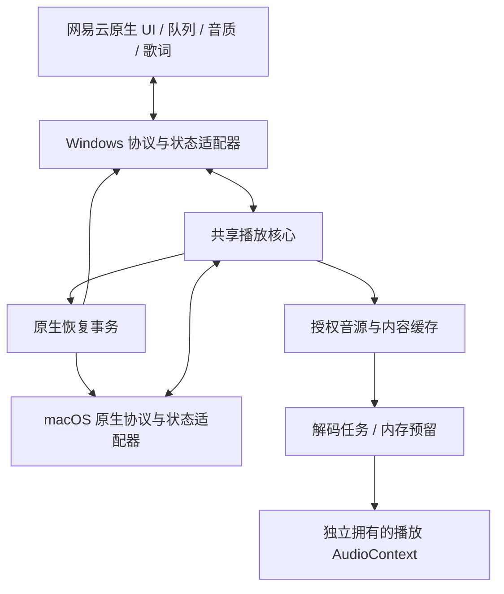
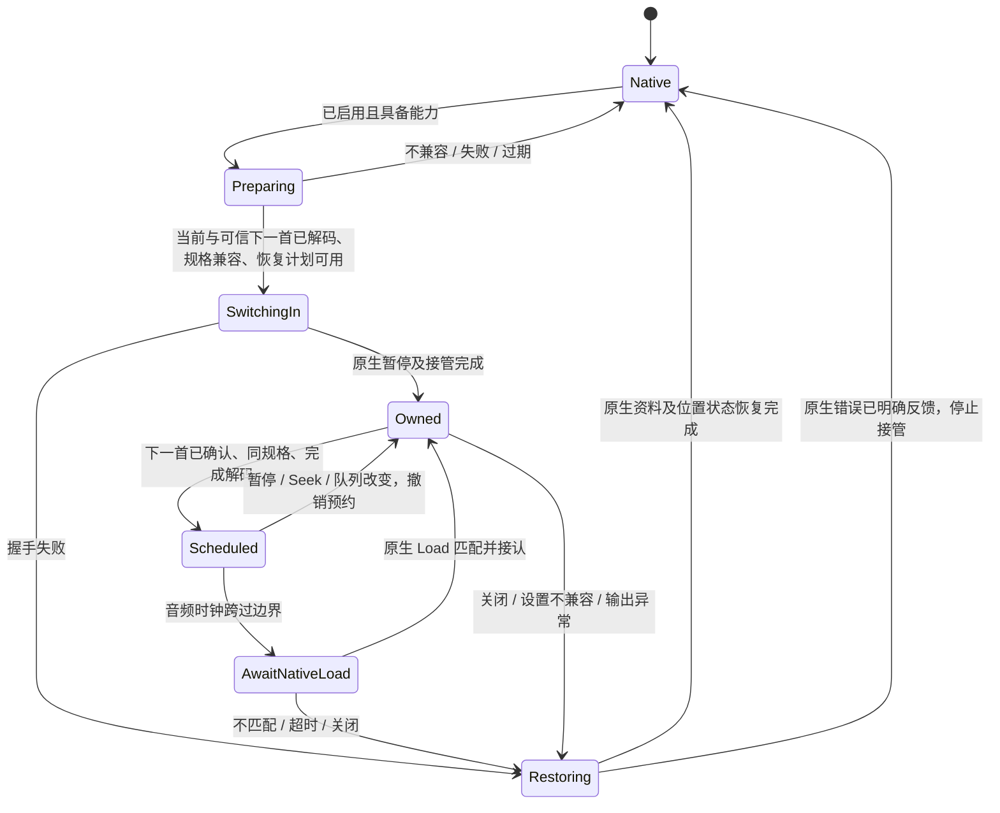

# Windows 无缝播放实施方案：与 macOS 功能一致

当前功能边界以 Mac 0.1.10 的 [临时 Web 桥接并交还原生](TEMPORARY_WEB_BRIDGE.md) 为准：约 10 秒曲尾/曲头窗口只决定何时准备和退出，必须双向校准输出位置，不能整首持续由 Web 播放。Windows 的原生预准备、输出选择与计时接口需独立验证；下文旧持续接管流程不能直接视为最新目标。

资源准备还应优先复用平台原生完整缓存，但必须验证当前授权、实际音质、MD5 与完整性；Mac 的 UC 缓存格式及文件路径不能直接套到 Windows，见 [缓存读取说明](CACHE_PRIORITY.md)。

版本：方案 v7，2026-11-14。配套：[原生可行性与 Windows 实现对照](NATIVE_GAPLESS_FEASIBILITY.md)、[0.1.0 历史源码审查](MAC_GAPLESS_AUDIT.md)、[Mac 安装与确认范围](../mac/README.md)、[0.1.2 副作用审查](SIDE_EFFECTS_REVIEW.md)、[0.1.3 间隔排查](AUDIBLE_GAP_REVIEW.md)、[0.1.4 卡顿排查](HANDOFF_HITCH_REVIEW.md)。

本方案可交给开发者逐项实施。当前 Mac 已修正并安装 0.1.4，进度竞态与接管范围见副作用审查，临近结尾接管、暂停缓存和实际渲染边界见间隔排查，输出冷启动及卡顿确认范围见卡顿排查，历史证据见 [0.1.1 记录](REMEDIATION.md)。Windows 精简版尚未编码、打包或实机验收；不能宣布两个平台现已功能一致。

## 0. 原生优先的入口检查

先在目标 Windows 版验证原生下一首预准备和持续输出能力，再决定是否实施第 2—8 节的 Web Audio 接管。Mac 3.1.12 的 `AudioPlayer.preLoad`、`subscribePreloadInfo`、`setPreloadInfoResult` 是空实现；这不能证明 Windows 的同名方法也不可用。两端功能一致不要求采用同一音频后端，但不能用“全部原生放行”冒充已实现无缝。

Windows 参考项目 NcmGaplessPlayer 1.20.0 的实际实现是截获 `channel.call`、后台下载并解码完整音频，用 `AudioBufferSourceNode.start(when)` 提前预约 B，代发原生 UI 事件；未命中时走 `<audio>`。其 `network.fetch` 只是原生网络请求，不是原生音频输出。固定 320k / 128k 兜底、响度平衡、拍点和混音面板不移植。已核对 `ncm-3x` 分支提交 `87e444c4599aac97f4a0de74421cea7853bbf1bc`；逐项证据见配套报告。

W0 增加以下入口条件：

1. 在实际加载的 SDK 中只读检查预加载方法体及对应原生命令/事件。方法存在、Promise 成功或通用原生命令目录中未出现名字，均不能单独作为能力判定。
2. 若发现真实原生预准备协议，先观察客户端自身的调用，再确认下一首由原生权威队列选定、音源沿用用户当前档位、预准备不会切换当前播放/曲名或关闭输出设备。
3. 只有确认准备完成、跨曲持续输出以及暂停、Seek、手动换歌、队列/音质变化的撤销语义，才实现薄适配：提交原生预准备资料与开关；不建立第二播放后端、不代发原生音频进度、不新增样式。
4. 若原生只能缓存文件或没有可调用协议，记录缺口后再进入本文 Web Audio 方案；缓存命中不能等同于采样边界连续。

新的 BetterNCM-v3 是一个候选宿主，声明目标为 Windows 网易云 3.1.41.205529，不能自动推广到其他版本。其原生命令扫描器的命名空间白名单不含 `audioplayer`，现有 250 命令目录不能用来否定无缝接口；W0 必须覆盖实际 SDK 和该命名空间。宿主发行包还包含主题/歌词插件，本项目范围只允许所需宿主和无缝插件，不能默认启用整套插件。[宿主说明](https://github.com/Leafmy/BetterNCM-v3/tree/438dddf6d6b6b6e75db2715828f47cb9a7a71446)、[扫描器范围](https://github.com/Leafmy/BetterNCM-v3/blob/438dddf6d6b6b6e75db2715828f47cb9a7a71446/tools/analyze_bundle.py#L32-L41)

当前没有可访问的 Windows 网易云实机，本轮完成的是参考源码与宿主协议资料检查；没有生成 Windows 插件，也没有宣布 Windows 原生无缝可用或不可用。

## 1. 功能一致的定义

若两端均需要 Web Audio，使用同一份播放核心、配置语义、兼容判断和回退规则。平台层只负责网易云原生协议、授权音源、原生状态、宿主配置及开关位置。修正已发现的 Mac 缺陷后，Mac 和 Windows 一起使用新核心；不把缺陷复制到 Windows。若 Windows 原生无缝链路通过第 0 节验收，应优先复用，不为共享实现而接管原生声音。

「功能一致」指可见功能和兼容策略相同，不承诺两个系统的驱动、解码器、输出延迟或数字输出完全相同，也不承诺不兼容曲目无条件无缝。

交付判定按下列 F01—F26 逐项执行。Windows 缺少任何目标功能都不算完成；例如常规 MP3/FLAC 解码、音质保持或原生恢复缺失，不能用“全部回退原生”代替无缝功能。若平台能力限制导致目标音频规格无法支持，应解决该能力缺口，或明确报告功能未达到一致，不能仅靠修改说明宣称达标。

| ID | 用户行为/能力 | 两端统一要求 | 当前 Mac 证据/缺口 |
|---|---|---|---|
| F01 | 自动加载 | 打开原有网易云应用，由平台宿主加载插件 | Mac 重开通过；Windows 宿主需现场确认 |
| F02 | 启用/关闭 | 一项「无缝播放」开关，状态持久化；关闭恢复原生位置、音量及播放/暂停意图 | 0.1.1 已复核关闭后持续播放、无刷新重新启用、刷新及候选接认失败恢复 |
| F03 | 普通连续播放 | 同一兼容音频时钟上，B 从 A 的结束时刻开始，不等待 UI/网络 | 0.1.3 两个场景实际立体声缓冲边界前后 400 ms 无静音帧；声卡输出/完整听感仍未验证，预约成功本身不足以验收 |
| F04 | 音质选择 | 读取网易云当前选择，不写音质配置，不增加插件音质选项 | 保留 Hi-Res 选择，按网易云曲目可用规格返回无损 |
| F05 | 授权音源 | 同账号、同选择、同原生授权路径获取音源；不添加低码率兜底 | Mac 使用原生 load URL 和签名 API；0.1.1 已复核 MD5/源指纹及规格 |
| F06 | 音量 | 准确继承原生音量，包括零音量；不设置人为最低音量 | Mac 原有 0.48 保留；不复制参考项目低音量改为 0.8 的逻辑 |
| F07 | 调音/混音 | 不引入淡入淡出、EQ、BPM、变速、响度平衡、扫频或自动入点 | 当前精简版未引入 |
| F08 | 作品留白 | 原样播放内容，不按波形自动裁剪留白 | 当前原样保留；编码器填充处理需按客户端验证 |
| F09 | 暂停/恢复 | 原生按钮、快捷键和 SDK 控制正常；暂停音频并取消候选预约，恢复位置不变 | 正常场景通过；0.1.1 已保护，旧 ID 暂停实机被忽略 |
| F10 | 拖动位置 | 尊重实例和目标位置，取消旧预约；每个已接收请求独立完成，进度只发布最新位置；初次交接中途拖动则等待原生完成后自动重新尝试接管 | 0.1.2 复核 Seek+暂停、快速两次 Seek、向后 Seek、接管中途 Seek及重新接管后实际跨曲；恢复时也使用串行响应，全部手势未穷举 |
| F11 | 手动上一首/下一首 | 原生队列决定曲目，不因旧预约多播/跳过一首 | 普通操作通过；边界操作未全面覆盖 |
| F12 | 顺序播放 | 按实际队列顺序；末尾无下一首时交回原生行为 | 已实现可信顺序预测、无候选资源清理；末尾行为未单独实机覆盖 |
| F13 | 列表循环 | 队列末尾到首项，实例标识不丢失 | 列表循环连续切歌通过；重复 ID 保持原生，末尾到首项未单独实机覆盖 |
| F14 | 单曲循环 | 同一曲目的下一次实例无额外交叉、裁剪 | 具备实现，未全面实机验收 |
| F15 | 随机播放 | 只有可信下一首才接管/预约；未知时原生播放 | 0.1.2 保持原生；0.1.1 只保证不预约，尚无可信随机下一首接口 |
| F16 | 心动/推荐 | 已知原生下一首且两首均准备好才接管，不自行生成推荐 | 0.1.2 保持原生；0.1.1 只保证不预约，尚无可信推荐下一首接口 |
| F17 | 原生进度/曲名 | UI、原生轮询和音频状态同步，End 每实例至多一次 | 正常切歌通过；已加候选接认状态、End 去重和累计听音；Mac getPlaybackInfo 是返回空对象的 SDK 占位，不能作为位置/设备验证依据 |
| F18 | 歌词 | 使用原生获取及渲染流程，随原生进度同步 | 原生歌词更新通过；0.1.1 已按原生字段就绪刷新，并复核异步实例 |
| F19 | UI | 首页、播放条、歌词页、主题保持原样；开关融入宿主已有设置 | Mac 手动样式检查通过；Windows 需原生样式验收 |
| F20 | 音频规格 | 可解码 MP3/FLAC、单/双声道、支持的普通到 Hi-Res 档位 | Mac 44.1/48 kHz 有使用证据；其他规格按能力判断 |
| F21 | 不同采样率 | 不强制把 B 转成 A 的较低采样率，该边界回退原生 | 保护意图已有；0.1.1 已用独立解码与播放/预约规格复核修正 |
| F22 | 原生音效/倍速 | 已启用音效、空间音频、音量均衡、非 1 倍速时保留原生处理 | 当前有判断；目标字段必须校验 |
| F23 | 特殊播放 | MV、播客/电台、特殊音质、多声道、试听/权限异常使用原生 | 当前有保护，字段映射需目标版确认 |
| F24 | 预加载失败 | 超时、断网、解码失败、资源不足时保持正常原生播放，不降级曲源 | 已加预算前置检查和有限重试；候选接认失败恢复实机通过；其他故障代码检查 |
| F25 | 内存与请求 | 主要保留当前与下一首；预算及并发策略两端共用 | 0.1.1 已有流式限额、在途预留、串行解码与引用统计 |
| F26 | 重开/休眠/设备变化 | 保留原生用户意图；不能可靠继续拥有时恢复原生 | 刷新恢复和等待真实输入通过；已监听上下文状态，系统休眠/设备切换仍需更长实机覆盖 |

允许的唯一可见扩展是开关和宿主设置内的简短兼容状态。不得引入另一个歌词页、播放器面板、浮动按钮组或主题覆盖。

## 2. 架构与代码组织



已实现 `shared/audio-resources.js` 和 `shared/playback-clock.js`，Mac 的控制、恢复、平台状态和开关仍在 `mac/player.js`。以下细分目录属于下一步抽取/Windows 实现规划，不是现有文件：

```text
shared/contracts.js          数据对象与适配器约定，JSDoc/运行时校验
shared/core.js               状态机、控制命令、边界接认与 End 去重
shared/scheduler.js          同时钟预约、取消、音频时间校正
shared/source-store.js       内容缓存、授权/音质失效与请求去重
shared/decoder.js            源规格检查、独立解码与内存预留
shared/native-controller.js  原生 load/seek/play/pause 恢复事务
shared/diagnostics.js        环形日志、状态快照及衔接诊断
shared/defaults.js           两端相同的策略与默认参数
mac/adapter.js               替代当前嵌入 player.js 的平台代码
mac/entry.js                 宿主入口、开关及能力检查
windows/startup_script.js    页面启动期记录 Windows 事件注册
windows/adapter.js           channel/SDK/队列/音源/宿主适配
windows/entry.js             Windows 插件入口与已有设置页开关
windows/manifest.json        Windows 专用声明
```

运行代码保持普通 JavaScript，不要求引入前端框架或项目构建。专用打包脚本可按依赖顺序组合成单个 `main.js`，加上 `startup_script.js`、manifest 和 MIT LICENSE，输出 `.plugin` ZIP 包；不能将当前 Mac 安装包直接复制到 Windows。

Windows 规划 slug 为 `gapless-player-windows`；修正后的共享核心和两个平台包使用同一核心版本。Windows 不依赖其他播放接管插件；只有在原生签名请求不可直接调用且确认兼容时，才将 LibEAPIRequest 用作请求辅助库。

## 3. 必须统一的数据模型

| 对象 | 必需字段及含义 |
|---|---|
| TrackRef | `trackId` 曲目内容 ID；`occurrenceId` 此次队列实例；`nativePlayId` 完整原生标识；`queueVersion` 队列版本 |
| QualitySelection | `requestedLevel` 用户选择；`qualityVersion` 选择代次；`accountEpoch` 授权代次；原生音效/倍速/设备设置 |
| SourceSpec | 原生 `actualLevel`、编码、源采样率、声道、源位深、总帧数/时长、文件大小、授权/试听标志、可核对的 fileId/MD5 等指纹 |
| DecodedEntry | 内容键、源规格、解码采样率、AudioBuffer、PCM 大小、预算票据；不把它当作播放实例 |
| PlaybackInstance | TrackRef、原始 load 参数、buffer 引用、offsetFrames、startTime、endTime、播放/暂停意图、loadEpoch、contextGeneration |
| Handoff | 前一原生完整快照、候选实例、实际音频跨界时刻、待接认原生请求、恢复计划、是否已发送 End |
| Command | 原始命令及回调、请求 ID、nativePlayId、实例/代次、来源类别、用户意图序号 |
| NativeSnapshot | 原生当前实例、位置、状态、音量、音质、完整原始 load 参数、时间戳、捕获时控制代次 |

严禁把 trackId、队列实例和原生 playId 混为一个值。缓存可以复用同一内容，控制、接认及 End 始终绑定到具体实例。

内容缓存键不能只使用 `trackId:level`。至少包含授权代次、请求音质及已确认的文件规格/指纹；URL 签名变化本身不意味着内容变化。没有足够规格/指纹时只能声明有限一致性，不能假定缓存必为同一音源。

## 4. 平台适配器契约

以下是需要实现的接口约定，不是已发现的网易云函数名。Windows 具体 Redux action、模块 ID 和签名函数必须先在目标客户端捕获，不能填入假名字直接运行。

| 适配器方法 | 输入/输出与约束 |
|---|---|
| `probeCapabilities()` | 确认宿主、原生调用/注册、回调契约、授权请求、队列、原生恢复、音频上下文；返回可接管能力和具体回退原因 |
| `readSnapshot()` | 返回规范化 NativeSnapshot；读取行为不修改原生设置 |
| `observeNative(listener)` | 订阅规范化原生事件，返回解绑函数；保留完整实例标识和协议原始来源 |
| `installCommandHook(handler)` | 仅拦截必要音频命令；队列通知只观察；异常必须恢复或放行原生 |
| `classifyCommand(request)` | 区分全局用户 transport、特定实例控制和旧流程 cleanup；决定等待接认期间如何处理 |
| `completeRequest(request,result)` | 按实测原生契约完成响应，至多一次；有些旧版本靠注册事件完成，不能盲目调用回调 |
| `emitNativeViewEvent(event)` | 调用原生 JS 注册处理器，必要时通知原生；该事件不能重新进入音频控制或被本插件吞掉 |
| `resolveSource(ref,selection,ticket)` | 通过原生授权机制获取同选择的 SourceSpec；不回退到另一档码率、不使用下载接口替代未经确认的播放权限 |
| `fetchBytes(source,ticket)` | 获取字节；支持取消时真正取消，不支持时过期结果丢弃并保留预算到结束 |
| `peekNext(snapshot)` | 返回 `{ref,queueVersion,confidence}`；只有原生确认的结果可预约，不能确定返回 null |
| `prepareRecovery(ref,snapshot)` | 在预约之前提供完整原生恢复资料，或经过验证的指定实例原生选曲入口；不能只是候选 URL |
| `callNativeRaw(command,args)` | 绕过本插件，按真实响应/完成事件返回结果；保留命令顺序和超时 |
| `ensureNativeSelection(ref,plan)` | 使用已验证的原生选曲流程恢复指定实例；只用于恢复，不额外推进队列 |
| `refreshNativeLyrics(ref,ticket)` | 原生数据准备完成后刷新已有歌词模型；异步返回后复核实例；不修改 DOM/样式 |
| `persistEnabled/readEnabled` | 使用平台宿主既有配置保存同一开关语义 |
| `dispose()` | 取消任务及解绑；只恢复本插件仍拥有的包装层，不能覆盖 SDK 后续合法变更 |

### Windows 原生协议映射起点

已有参考代码使用 `channel.call(name, callback, args)`，并记录 `channel.registerCall` 与 `legacyNativeCmder.appendRegisterCall` 的 JS 处理器。可以借鉴该结构，不能照搬它对 channel.call 后续 setter 一律拒绝的做法。[Windows 注册入口源码](https://github.com/AntsandIce/NcmGaplessPlayer/blob/ncm-3x/src/startup_script.js)、[播放实现源码](https://github.com/AntsandIce/NcmGaplessPlayer/blob/ncm-3x/src/main.js)

| 项目 | 参考实现/当前 Mac 的已知形状 | Windows 必须确认的内容 |
|---|---|---|
| load | `[nativePlayId, info]`；info 有曲目/音源/规格 | musicurl 是否是可请求 URL、加密 token 或本地资源；完整恢复资料 |
| play / pause | `[nativePlayId, token]` | token 状态及用户控制/清理来源、回调完成时机 |
| seek | `[nativePlayId, token, seconds]` | 命令响应与注册 Seek 通知的顺序，实例关联 |
| volume | 原生参数与事件包含当前音量 | 参数下标、0—1/0—100 量纲、零音量及初始化 |
| Load 事件 | Mac 为 `[id,{code:0,duration}]`；Windows 参考额外带 activeCode/error 字段 | duration 单位、响应和注册事件是否都需要、错误行为 |
| PlayState | 已知 1 播放、2 暂停 | SDK 暂停标记和 token 校验 |
| PlayProgress | `[id, positionSeconds, bufferedRatio, optionalForce]` | 原生实际参数类型、进度节流及 force 语义 |
| Seek 事件 | `[id,token,code,position]` | 成功/失败事件与当前订阅关联 |
| End | Mac End/getPlayedTime 均为累计听音秒数；Windows 参考用 playedMs | 时间单位、实际收听/位置语义、原生推进去重 |
| getPlayedTime / getPlaybackInfo | 参考为 `{playId}` 请求；Mac 不伪造设备格式，且其 getPlaybackInfo SDK 直接返回空对象 | Mac 实测 getPlayedTime 为秒，两个字段均表示累计听音，独立于位置；Windows 必须另测单位和含义，避免错误 result 导致额外推进 |

核心内部位置统一为秒/整数帧，累计听音另行计时；外部协议单位仅在适配器转换。源位深、解码 float32 与真实设备格式分别记录，不能把 buffer 规格伪装成已查询的声卡规格。

Windows 3.x 音源字段可能不是普通 URL。优先使用原生播放器可用的授权资料和签名函数；无法可靠解析时使用已验证、可保持当前 level 的 LibEAPIRequest 路径；仍失败就保持原生播放。不复制参考项目固定 br=999000、320k、outer/url(128k) 或 download/url 兜底。

启动脚本应使用本插件命名空间记录处理器，避免与其他库的全局 registeredCalls 冲突；按函数身份去重；既能记录启动注册，也能处理 SDK 重新注册。包装只覆盖必要入口，能够合法重新安装并恢复。

## 5. 共享状态机与不变量



播放/暂停意图单独存储，不能由 phase 推导。Handoff 独立保存实际可听实例和原生显示实例；原生还显示 A 时，不能误认为所有控制都针对 B。

必须满足：

1. 有效出声后端至多一个；发生后端交接时由事务明确协调，不靠固定延迟猜测。
2. 下载/解码任务不创建、替换或关闭播放 AudioContext。
3. 每个音源的 start/stop/onended 都绑定实例、contextGeneration 和控制代次。
4. 每个原生请求至多完成一次，每个曲目实例的 End 至多发送一次；恢复不得额外发 End 推进队列。
5. 不会在没有有效恢复计划时进入下一首预约。
6. 用户全局暂停始终有效；旧实例清理命令不会 seek、stop 或重开当前实例。
7. 只有源采样率、解码采样率、播放上下文采样率及必要规格均匹配的候选才可预约。
8. 所有异步回调重新校验 loadEpoch、controlRevision、queueVersion、qualityVersion、accountEpoch。
9. 过期任务可以留下可复用的已授权内容缓存，但不能操作播放器、替换上下文或向旧实例发送新进度。
10. 正常退出拥有状态会明确恢复原生，或明确反馈原生错误；不会 silent stop 后仍让 UI 显示正常播放。
11. 没有可信、已准备好且兼容的下一首，不得为单首播放替换原生后端；后台准备本身不暂停原生。
12. Seek 的音频位置立即采用最新意图；回调仍逐个完成，过期请求不得发布旧进度。取消后端交接也必须完成已接收 Seek，并按最新播放/暂停意图解除原生暂停。

## 6. 连续调度、取消与接认算法

### 6.1 当前曲目准备

读取原生快照与实际 SourceSpec。只有正在播放且下一首可信时才后台准备当前曲目，再准备下一首；原生继续播放，保留完整 load 参数并预留内存。两首都已解码、规格兼容且恢复计划可用后才接管。保留正在进行的当前曲目任务，不能因下一首尚未开始准备而每次心跳取消该任务。需要用户手势时先让原生播放；没有可运行上下文就不消费播放命令并假装成功。

解码在独立的源采样率上下文完成，结果须验证 sourceRate、decodedRate、frames、channels。进入接管事务及每次等待后复核曲目、队列版本、候选、设置、控制代次和原生状态。原生暂停完成后获取最终位置，启动共享核心；中途用户换歌、拖动或暂停会取消旧事务。取消时等待进行中的原生 Seek，再按最新播放/暂停意图解除暂停；初次准备/交接时用户 Seek 仅推迟接管，等待 Seek 完成及位置稳定后自动重试，并保留解码资源。Mac 使用 400 ms 稳定窗口，不让整首退出无缝。0.1.3 接管入口至少剩余 0.5 秒，每次异步等待后至少剩余 0.12 秒，下一首预约提交仍要求 0.08 秒；Windows 需根据实际握手耗时验证这些同核参数，不能复制旧的 2 秒门槛导致已准备曲目错过接管，也不能去掉所有期限保护。首次接管可能涉及两条设备输出路径，不能将其声明为已证明的采样级无缝。

### 6.2 下一首准备与预约

下一首来源必须是实际队列的权威结果。获取同音质授权音源、同规格 buffer 和恢复计划后，尽早预约。音频边界由解码实际帧数和播放 offset 计算，不使用 API 的四舍五入时长替代。

```javascript
// 算法约定，尚非运行文件。
function scheduleCandidate(current, candidate, ticket) {
  if (!isTicketCurrent(ticket)) return useNativeAtBoundary('stale-ticket');
  if (!userIntent.playing || context.state !== 'running') return;
  if (!hasAuthoritativeNext(candidate.ref)) return useNativeAtBoundary('unknown-next');
  if (!hasRecoveryPlan(candidate)) return useNativeAtBoundary('missing-recovery');
  if (!samePlayableSpec(current, candidate, context)) return useNativeAtBoundary('spec');
  const boundary = current.startTime + current.remainingFrames / context.sampleRate;
  if (boundary - context.currentTime < minimumSubmitLead) {
    return useNativeAtBoundary('missed-deadline');
  }
  // 再验证代次，确保 source 创建后没有状态变更。
  const next = makeSource(candidate, context);
  next.start(boundary, 0);
  rememberHandoff(current, candidate, boundary, ticket);
}
```

每个候选只提交一次。播放速率 1、detune 0、gain 精确等于当前原生音量，无额外交叉或增益自动化。每一次缓存命中仍复核规格，不绕开异采样率保护。

播放中 UI 状态心跳可保持 150 ms；暂停只在状态/位置改变时发布一次，不发送重复进度。歌词异步完成不触发播放进度。预约时机为就绪后立即提交。minimumSubmitLead 是保护余量，必须大于已知提交延迟和渲染余量；不足就回退，不把迟到 start 算为成功无缝。

### 6.3 跨界与原生 Load 接认

控制入口、状态心跳和 onended 都调用同一 `reconcileAudioClock()`。音频时钟已经越过边界时即承认候选已可听，不等 JS 的 onended 才改变内部状态。onended 负责实例资源回收和一次性通知，不能重复推进。

原生正常流转到 B 并发出 Load 时，比较：队列实例、原生 playId 关联、请求音质、实际规格、音源内容标识和授权代次。匹配则接认已经开始的 B；按目标 SDK 契约发送响应和 Load 通知，完成原生准备及歌词流程。不同则取消候选并按原生实际选曲恢复。

等待接认期间，原生轮询按“显示实例/可听实例/原生流程”真实映射回应；不能把所有旧 ID 查询放给已暂停后端返回 result:false。用户 transport 暂停作用于可听后端；针对 UI 显示旧曲目的 Seek 应取消候选并按其目标实例执行，不能把旧位置直接套到 B。

### 6.4 取消与迟到任务

暂停、Seek、手动换歌、队列改变、音质改变、授权变化、关闭和输出异常都触发相关代次递增。尚未开始的候选立即 stop 并断开；已开始候选进入受控恢复，记录实际位置和用户意图。旧回调不得恢复已取消的候选。

原生SDK完成事件的排序由平台契约确定；例如目标 Seek 需要先完成命令响应再订阅事件时，要严格按该协议安排通知，不使用通用固定 timeout 替代。

## 7. 原生恢复事务

正常恢复必须按以下流程，而不是连续无等待地发出 load/seek/play：

1. 捕获当前可听实例、位置、音量、用户播放/暂停意图和控制代次。
2. 若实例已有完整原生 load 资料，使用保留的原始参数；等待接认的候选则使用预先验证的恢复计划及指定实例原生选曲入口。
3. 暂停/停止 Web Audio 与原生准备按平台能力握手，防止两个后端同时出声。回退允许短时加载等待，不宣称仍无缝。
4. 等到原生加载完成，再执行 Seek；确认 Seek 完成后，应用最新用户意图和原生音量，最后 play 或保持 pause。
5. 每一步检查控制代次。期间用户换歌/拖动/暂停优先，旧恢复不能稍后覆盖新操作。
6. 成功后解除本实例的原生事件屏蔽，清理节点和预算；后端错误则走原生错误反馈，不无限重试、不静默停声。

等待接认超时只恢复当前候选，不再发送一次 End。若原生已选中候选但仍在准备，接续该准备流程；若队列已改变，则遵从原生新的选择。

开关关闭需要先启动恢复事务并保存 disabled。平台宿主若会强制刷新页面，应使用可控的配置入口等待恢复，或让新页面通过短时恢复记录主动完成恢复。不能依赖 beforeunload 中的多阶段异步调用保证成功。

## 8. 内存、网络与兼容策略

### 8.1 统一预算

默认保留当前和下一首，不增加 N+2、磁盘缓存、分析缓存或后台补算。512 MiB 是两端共用的插件管理预算上限；包括 PCM 持有及任务预留，不能当作整个浏览器/客户端进程峰值保证。无法满足该预算的宿主应保守回退。

下载前通过原生时长及源头部总帧数估算 PCM：`frames × channels × 4`，额外预留压缩字节和解码临时空间。先进行预算准入，再下载或解码。一次仅一个解码任务；优先当前曲目，再下一首。未能可靠估算的大文件不预加载。流式读取设字节上限，即使 Content-Length 缺失也可停止。

移出缓存不等于内存已释放；音源引用仍存活时计入预算。任务被取消但原生网络仍在传输时，预留不能提前归还。使用引用计数/票据统一管理，关闭时可实际中止的任务才立刻释放在途预留。

### 8.2 失败分类

| 类别 | 行为与重新尝试条件 |
|---|---|
| 不支持的采样率、编码、声道、输出模式 | 当前规格/上下文/设备代次内不重试，保留原生播放 |
| 权限、试听、授权失败 | 当前授权/权限代次内不重试，不尝试低码率或下载权限绕路 |
| 瞬时网络失败/限流 | 有限退避，重试不得拖住正常原生加载；预算与播放期限不足时放弃 |
| URL 过期 | 仍有原生权限且源规格可确认时重新走同选择签名请求，至多有限次数 |
| 解码失败/资料矛盾 | 标记本内容不兼容并回退；有新源指纹才允许重试 |
| 用户取消/任务过期 | 不计为网络故障；丢弃旧结果，禁止写播放器状态 |
| 无下一首 | 清理候选、过期请求及无引用缓存，保持原生队列末尾行为 |

后台 API 请求、下载和解码都有超时及取消票据。具体超时/退避参数写入 shared/defaults，两个平台共用；原生平台确有不同命令完成时间时使用适配能力数据，不能无记录地修改用户行为。

### 8.3 音频与平台能力

只在目标客户端可解码、可以维持相邻曲目同采样率且保留原生处理要求时接管。源采样率与播放上下文匹配只能控制插件内部路径，不能证明声卡无转换。[Web Audio 标准](https://www.w3.org/TR/2021/REC-webaudio-20210617/)

如果目标客户端提供指定输出设备、独占或直通模式，而 Web Audio 不能沿用，应该保持原生播放；不新增设备设置或默默忽略原生选择。不能把“Hi-Res 档位没改”当作已经证明独占/直通输出一致。

默认不裁作品留白、不做人为自动 trim。MP3 编码器填充由实际解码器行为决定，需确认连续素材在两平台的解码时长和接缝。能力不同导致回退范围不同属于平台边界，应记录而不是包装成全曲目等价。

## 9. UI 接入与一致性验收

Windows 首选 BetterNCM 已有插件设置页的一项开关。只需“无缝播放”“当前因原生音效/规格不兼容使用原生播放”等已有设置区域内的状态；不搬入参考项目的 ♪ 面板、音色/缓存分页或新歌词窗。

如确需标题栏按钮，必须使用当前 Windows 原生版本的按钮容器及样式：同字体、图标大小、点击区域、间距、颜色、hover/focus 状态、主题和窗口拖拽区域行为。样式只作用于新增元素；不添加通用 body/button/reset，也不覆盖原生布局变量。框架无现成样式时先完成对照后才接入。

验收以插件关闭的同版本网易云为基线，对比首页、播放条、歌词页和插件设置页。检查：原有元素布局/尺寸不变、主题与字号不变、封面/歌词渲染仍属原生、进度/按钮状态正确、不同窗口宽度无挤压、键盘焦点及可访问性可用。图片内容、滚动进度和正在播放动画应区别于布局差异。

Mac 保持歌词窗口关闭，Windows 不安装歌词替换插件。两端开关可以位于各自原生合适入口，不要求机械复制 Mac 标题栏坐标；功能和视觉融入要求保持一致。

## 10. 诊断与手动验收标准

日志仅记录必要 ID、代次、规格、状态和时刻，不记录完整签名 URL、cookie、歌词正文或账号秘密。保留有限环形日志；状态接口是只读诊断，不默认显示独立面板。

必需诊断字段：核心/平台/客户端版本；sourceRate/decodedRate/contextRate；期望边界时间；提交时 contextTime；submitLead；是否 missedDeadline；End 去重结果；实际原生 Load 接认延迟；回退原因及恢复结果；预算 held/reserved；任务取消与过期次数。

`scheduledGapFrames = round((B.requestedStart - A.expectedEnd) × rate)` 只表示预约参数，不能命名为硬件实测 gap。最终交付必须同时提供实际客户端证据，必要时数字输出/回录分析。

| 验收范围 | 通过标准 |
|---|---|
| 同采样率连续素材 | 当前/下一首已就绪，无人为交叉、裁剪和额外空挡；诊断提交在期限前，音频输出对照没有播放器新增间隔 |
| 手动控制与边界 | 暂停、恢复、拖动、上一首/下一首符合原生意图；无旧命令覆盖、双声、错歌或跳过一首 |
| 队列与模式 | 顺序/循环/单曲/随机/推荐按实际原生队列；重复曲目实例正确；无法确认的下一首按规定回退 |
| 原生状态 | 曲名、进度、按钮、歌词和 native poll 一致；每实例只推进一次；慢歌词请求不会刷新旧实例 |
| 音质/音量 | 配置前后不被写改，零音量保留；实际源规格和授权一致；不出现插件主动码率下降 |
| 不同规格/特殊功能 | 异采样率、特殊音质、音效、倍速、多声道、试听和特殊资源保留原生行为 |
| 故障恢复 | 断网、超时、解码失败、预算不足、未接认、输出暂停时，恢复位置/意图正确或明确原生错误，没有静默失控 |
| 生命周期 | 关闭/开启、原应用重开、窗口最小化、休眠唤醒、输出设备变化可控；不依赖卸载异步完成 |
| UI | 按上一节的基线对照确认原生布局、主题、歌词与操作一致性 |
| 资源占用 | 任务有准入与取消，PCM/在途预算可解释，不重复下载永久不兼容内容，不引入后台分析负担 |

手动验收与既有工具足以按用户要求开展。本方案没有要求默认新增自动化测试、全仓 lint/tsc 或应用构建；如需要进一步自动化，应单独确定范围。

## 11. 实施顺序与每阶段交付

| 阶段 | 工作 | 完成证据 |
|---|---|---|
| M0 · 固定基线 | 保存当前 Mac 实际安装源码、版本、成功日志与 UI 基线；确认审查 D01—D12 | 现有 Mac 包可回退，问题和证据可追溯 |
| M1 · 共享核心修正 | 拆出核心，优先修上下文、恢复计划、代次、握手、预算，再处理队列/权限/生命周期 | Mac 同一功能重验；未新增调音/UI 功能 |
| W0 · 目标能力捕获 | Windows 完整版本、进程架构、宿主框架、回调、队列、签名取址、恢复资料、设备能力 | 真实参数/时序映射表，无未知关键接口 |
| W1 · Windows 适配 | 实现第 4 节契约、单一开关和诊断；共享 M1 核心，不移植完整版 DSP/UI | 原生播放可正常放行，接管/恢复事务完整 |
| W2 · 实机功能与 UI | 按 F01—F26 和第 10 节验收，记录平台能力导致的回退范围 | 实际连续播放及故障恢复证据，原生样式对照 |
| W3 · 安装包与交付 | 生成 Windows 专用 `.plugin`、固定兼容宿主版本、安装/关闭/回滚说明及 MIT 许可 | 安装后原应用可正常打开，关闭恢复，版本明确 |

不能仅凭 Windows JS 语法检查宣布功能与 Mac 一致；必须完成原生协议和实际播放/恢复验收。可用平台差异若影响相同功能的兼容范围，应在交付说明中逐项列出。

## 12. Windows 安装与回滚设计

确认的是网易云进程/可执行文件架构，不能只看 Windows 系统是 64 位。宿主 DLL 必须与进程架构匹配，插件 JavaScript 本身不区分位数。现有原仓库已更名为 chromatic，维护者保留 BetterNCM 存档与 1.3.4 Release；选择兼容旧插件框架，不自动使用任意最新版。[维护者说明](https://github.com/std-microblock/chromatic)、[BetterNCM 1.3.4](https://github.com/std-microblock/chromatic/releases/tag/1.3.4)

插件安装流程：先确认目标客户端受支持，安装/复用兼容宿主，将实际接管播放的其他插件关闭并保留备份，再把 Windows 精简包放入宿主实际 profile/plugins，重启原有网易云应用，确认设置页开关及能力状态。参考默认目录是 `C:\betterncm\plugins`，有 BETTERNCM_PROFILE 时使用实际 profile。[参考安装目录说明](https://github.com/AntsandIce/NcmGaplessPlayer/blob/ncm-3x/install/README.md)

不得让本安装流程缺少精简包时自动下载参考项目完整版。不得为了安装精简版默默启用歌词/调音插件。宿主 DLL、旧插件和配置需保存可恢复副本；插件关闭后恢复原生，移除精简包时不删除其他插件、账号资料或用户音乐缓存。

回滚分两层：只回滚精简插件时使用开关/备份包；撤回宿主时遵循对应宿主的原生卸载流程。Mac 当前安装继续保留，任何后续共享核心升级都先保存现有可用包。

## 13. 仍需 Windows 实机补齐的事实

Windows 网易云完整版本/进程架构尚未提供；原生签名 URL v1 函数、队列实例/peekNext、歌词准备完成通知、Load/Seek 回调顺序、指定实例的恢复入口、设备输出及宿主配置 API 都需要在实际版本确认。

这些是 W0 阶段的明确交付项；方案已给出所需输入输出、降级行为和阶段标准，不把未确认的内部名字写成可运行命令。Mac 当前为 0.1.4；没有生成或部署 Windows 版本。

## 14. 0.1.1 已确认的移植注意项

Mac 恢复流程会经过空 ID stop 清理命令；恢复事务不得因此失效。已暂停的后端可能只确认 pause RPC，不发新的状态事件。Mac getPlayedTime 的两个计数字段均为累计听音秒数，不能复制旧版毫秒/当前位置实现。原生实际曲目音质字段与用户配置不同；观察用户配置，不能因原生回落 lossless 而错误回退。

本插件开关复用宿主已有 UI 和保存 API，独立切换无需刷新页面，关闭后持续原生播放。Windows 应找等效的宿主持久化接口；不得直接照抄 Mac 本地 API 地址、凭证字段或原生命令参数。

## 15. 0.1.2 进度与最小接管要求

Mac SDK 在 Seek RPC 完成后才订阅 Seek 通知，而且不按 token 过滤；快速完成多个 RPC 会让不同请求收到同一通知。当前修正将 RPC 确认及对应通知串行发送，音频位置仍立即采用最后一次 Seek。暂停、换歌或控制代次变化不能让已接收请求永远不完成；过期实例返回失败并完成自身请求。首次交接中的原生 Seek 完成事件先缓冲，待 RPC 与 SDK 订阅顺序满足后交付；恢复期间使用同一策略。Windows 必须现场确认订阅行为，不能假设与 Mac 一样。

宿主可能用“位置增加”推断播放状态。暂停 Seek 发布目标进度后必须同步真实暂停状态，恢复完成后的原生暂停进度不得让 UI 自动变成播放。此保护只作用于插件拥有或恢复的实例；不要重写宿主全局进度策略。

当前与下一首都准备好才接管；未知下一首、不兼容模式或候选准备失败继续原生，已接管后队列失去可信下一首则恢复原生。仅保留无缝所需的预加载、共享时钟、UI 协议与保护；不要新增播放面板、音质入口、淡化或歌词界面。

## 16. 0.1.3 缓存与真实声音验收要求

暂停只停止音频和撤销预约，保留已准备的当前曲目及可信下一首；暂停不新发下载，已有任务允许按取消/预算规则完成。同账号、同请求档位和同源指纹的原生 Load 应同步接认已有 buffer；不能在 Load 到 play 的状态空窗清除缓存。队列、账号、音质或源身份变化仍须失效，关闭和未知下一首仍按已有规则清理。

验收同时记录曲目内容、实际渲染边界和原生协议。预约 0 帧间隔、End、Load 接认成功只能作为协议证据，不能代替音频输出。可用分声道的短时被动环形缓冲检查新增静音，再进行实际播放或数字环回对照；采样需完整覆盖边界，避免用界面线程回调缺失推断音频断流。诊断只在验收期间启用，结束立即移除，不增加常驻分析或新的 UI。

Mac 0.1.3 仅证实上述两种场景的渲染缓冲连续；初次原生后端交接、声卡输出和用户完整听感仍未判定。Windows 不得以复制这些日志代替本机验收，也不因作品留白或听感差异擅自增加裁剪、交叉淡化或降音质。

## 17. 0.1.4 输出冷启动与暂停保护

不能仅凭 AudioContext.state 为 running 就暂停原生。先在原生仍播放时等待 getOutputTimestamp 的两个时间字段相对初值推进，采用 500 ms 超时保护；等待中检查上下文、规格和状态，返回后再复核实例及控制意图，失效则取消。API 不可用或输出未推进时保持原生。进入暂停事务前再确认原生仍播放；外部原生暂停不一定经过插件命令入口，不能只靠 controlRevision 判断意图。

Windows 在 W0/W2 实测此能力及启动耗时，保留接管余量和取消/恢复保护。输出时间戳可用只说明输出流已开始推进，不证明两个后端之间零间隔；声卡实际输出与界面线程卡顿分开记录。此等待仅在接管准备期间进行，不增加常驻波形分析，不为降低延迟擅自变更音源、音质、输出采样率或声音包络。
